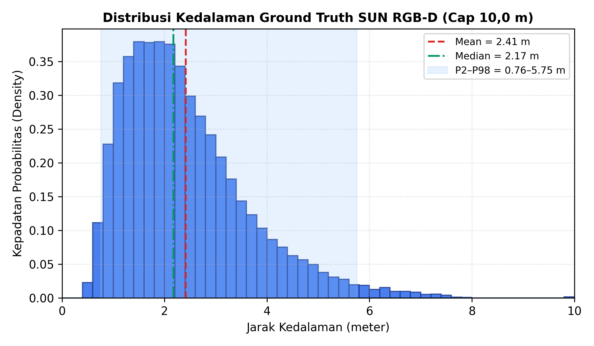

## 1.3.2 Detail Dataset

Dataset yang digunakan pada penelitian ini merupakan gabungan dari dua sumber data publik, yaitu **SUN RGB-D** sebagai sumber utama supervisi deteksi objek sekaligus *ground truth* kedalaman (*depth map*), serta **MS COCO 2017** sebagai pengaya variasi objek deteksi 2D. Seluruh statistik di bawah diverifikasi langsung melalui *loader* `discover_sun_records` dan `discover_coco_records` pada berkas `train_arsitektur.py`.

### 1. Sumber dan Struktur Subset SUN RGB-D
- **Subset dan Sensor**: Dari direktori lokal `datasets/SUNRGBD`, *loader* memindai berkas anotasi `annotation2Dfinal/index.json` dan menemukan **2.001 citra** yang valid (seluruhnya berasal dari subset `SUNRGBD/kv1/b3dodata` menggunakan sensor Microsoft Kinect v1; 2 citra pada subset tersebut dilewati oleh *loader* karena berkas JSON anotasi tidak dapat dibaca).
- **Mode Label & Pemetaan Kelas**: Konfigurasi *checkpoint* mencatat `LABEL_MODE=SUNRGBD`. Anotasi 2D pada SUN RGB-D dipetakan ke 4 kelas target proyek (`person`, `laptop`, `cell phone`, `bottle`) melalui pencocokan nama objek pada `annotation2Dfinal/index.json`. Peta kedalaman 16-bit dibaca dari direktori `depth/` atau `depth_bfx/` dengan dekode *bit-shift* standar SUN RGB-D (`((d >> 3) | (d << 13)) / 1000.0`) menjadi satuan meter.

### 2. Sumber dan Filter Subset MS COCO
- **Versi dan Anotasi**: Menggunakan anotasi resmi **MS COCO 2017** (`instances_train2017.json`) yang disaring khusus untuk 4 kelas target (`person`, `laptop`, `cell phone`, `bottle`) dengan batas ukuran *bounding box* minimum (`min_box_px = 4.0`).
- **Jumlah Citra**: Sebanyak **749 citra** lokal COCO tersaring dan dimuat bersama dataset utama. Karena citra COCO tidak memiliki peta kedalaman (*depth map*), piksel *depth* pada citra COCO di-*mask* (bernilai 0) sehingga hanya berkontribusi pada *loss* deteksi objek dan tidak ikut dalam perhitungan *loss* maupun metrik kedalaman (MAE, AbsRel, RMSE, $\delta_1$).

### 3. Resolusi Citra Asli dan Masukan Model
- **SUN RGB-D (`2.001` citra)**: Seluruh citra memiliki resolusi asli yang seragam sebesar **561 × 427 piksel** (lebar × tinggi).
- **MS COCO (`749` citra)**: Resolusi asli bervariasi dengan ukuran minimum **360 × 239 piksel**, maksimum **640 × 640 piksel**, dan modus **640 × 480 piksel** (166 citra).
- **Pra-pemrosesan Masukan Model**: Sebelum masuk ke jaringan, setiap citra diubah ukurannya secara proporsional menggunakan *letterbox* (*padding* abu-abu `114`) menuju resolusi masukan standar **`480 × 640` piksel** (`[1, 3, 480, 640]` pada runtime `multitask_best.pt` dan arsitektur usulan; serta `384 × 640` pada run pelatihan lokal `rtx4050_arsitektur_70_20_10`).

### 4. Rentang Jarak *Ground Truth Depth*
Berdasarkan pengukuran langsung terhadap seluruh **438.057.263 piksel valid** (91,39% dari total piksel pada 2.001 peta kedalaman SUN RGB-D dengan batas *cap* `DEPTH_MAX_M = 10,0 m`):
- **Minimum**: `0,373 m`
- **Maksimum**: `10,000 m` (batas *cap*)
- **Rata-rata (*Mean*)**: `2,411 m` (simpangan baku `1,232 m`)
- **Median**: `2,173 m`
- **Persentil 2% – 98%**: `0,756 m – 5,754 m`

*Gambar 1.5 Distribusi nilai kedalaman ground truth pada subset SUN RGB-D (cap 10,0 m) dengan penanda mean (2,41 m), median (2,17 m), dan rentang persentil 2%–98% (0,76–5,75 m). Sumber: Penulis.*

### 5. Rasio Pencampuran Data (`COCO_MIX=0.3` vs Realisasi Aktual)
Konfigurasi `multitask_best.pt` mencatat `COCO_MIX=0.3` (`N_VAL=500`, `N_TEST=500`), sedangkan skrip pelatihan lokal `train_arsitektur.py` memakai parameter `--coco-ratio 0.5` dengan pemisahan berbasis grup 70:20:10. Alasan penggunaan parameter `COCO_MIX=0.3` tidak terdokumentasi secara eksplisit di dalam *notebook* maupun log pelatihan; secara desain teknis, pencampuran sekitar 30% citra COCO bertujuan menambah variasi latar belakang dan sampel objek berukuran kecil (`cell phone`, `bottle`, `laptop`) yang jumlahnya sangat terbatas pada SUN RGB-D, sementara SUN RGB-D tetap dipertahankan sebagai mayoritas (~73%) agar supervisi *depth* tetap dominan.

Pada realisasi aktual di *disk* (`2.750` citra total), proporsi citra COCO adalah **749 dari 2.750 citra (27,24%)** — atau **37,43%** jika dibandingkan terhadap jumlah citra SUN RGB-D (`749 / 2.001`). Pembagian antar-*split* tetap konsisten: Train `524 / 1.922` (27,26%), Validation `150 / 553` (27,12%), dan Test `75 / 275` (27,27%). Studi ablasi variasi `COCO_MIX` (`0 / 0,3 / 0,5`) belum dijalankan karena keterbatasan waktu pelatihan dan disarankan sebagai eksperimen lanjutan pada Sub-bab 4.7.

### 6. Distribusi Data per Kelas dan Konsistensi Split (70:20:10)
Verifikasi terhadap seluruh berkas menghasilkan total tepat **2.750 citra** (`1.922 + 553 + 275 = 2.750`) dengan **4.446 anotasi kotak (*bounding box*)** yang konsisten 100% dengan Tabel 4.2 pada draf laporan sebelumnya.

**Tabel 1.1 Distribusi Data per Kelas dan Pembagian Dataset (Gabungan SUN RGB-D + MS COCO)**

*Sumber dataset: SUN RGB-D (`kv1`, 2.001 citra) + MS COCO 2017 (749 citra) | Rasio split: 70% Train (1.922) / 20% Val (553) / 10% Test (275) | Ukuran input: 480 × 640 (letterbox)*

| Kelas | Sumber (SUN RGB-D / COCO) | Train (Bbox) | Validation (Bbox) | Test (Bbox) | Total Bbox | Proporsi (%) |
|-------|---------------------------|-------------:|------------------:|------------:|-----------:|-------------:|
| `person` | SUN RGB-D (132) + COCO (1.924) | 1.377 | 475 | 204 | 2.056 | 46,24% |
| `bottle` | SUN RGB-D (987) + COCO (626) | 1.037 | 326 | 250 | 1.613 | 36,28% |
| `laptop` | SUN RGB-D (78) + COCO (381) | 326 | 85 | 48 | 459 | 10,32% |
| `cell phone` | SUN RGB-D (2) + COCO (317) | 210 | 73 | 36 | 319 | 7,17% |
| **Total Kotak (Bbox)** | **SUN RGB-D (1.199) + COCO (3.248)** | **2.950** | **959** | **538** | **4.447** | **100,00%** |
| **Total Citra** | **SUN RGB-D (2.001) + COCO (749)** | **1.922** | **553** | **275** | **2.750** | **100,00%** |

*Sumber: Penulis (diverifikasi dari `eval/dataset_distribution.csv`)*

### 7. Catatan Protokol Pembagian Data
1. **Split Sebelum Augmentasi**: Pemisahan data menjadi *Train*, *Validation*, dan *Test* dilakukan terlebih dahulu melalui `_split_records_by_group(seed=42)` berdasarkan grup adegan (*scene group*) sebelum proses augmentasi dijalankan.
2. **Isolasi Augmentasi**: Augmentasi geometrik (*random horizontal flip*, *scale jitter* 0,2, *translate jitter* 0,08) dan fotometrik (*HSV jitter*) hanya diterapkan pada *Train set* (`train=True`), sedangkan *Validation* dan *Test* hanya melewati proses *letterbox* deterministik (`train=False`).
3. **Status *Data Leakage***: Karena pemisahan SUN RGB-D dilakukan per grup adegan (*scene prefix*), citra dari ruangan/sesi yang sama tidak tersebar ke *Train* dan *Test*, sehingga risiko *data leakage* antar-frame berurutan dapat dicegah.

