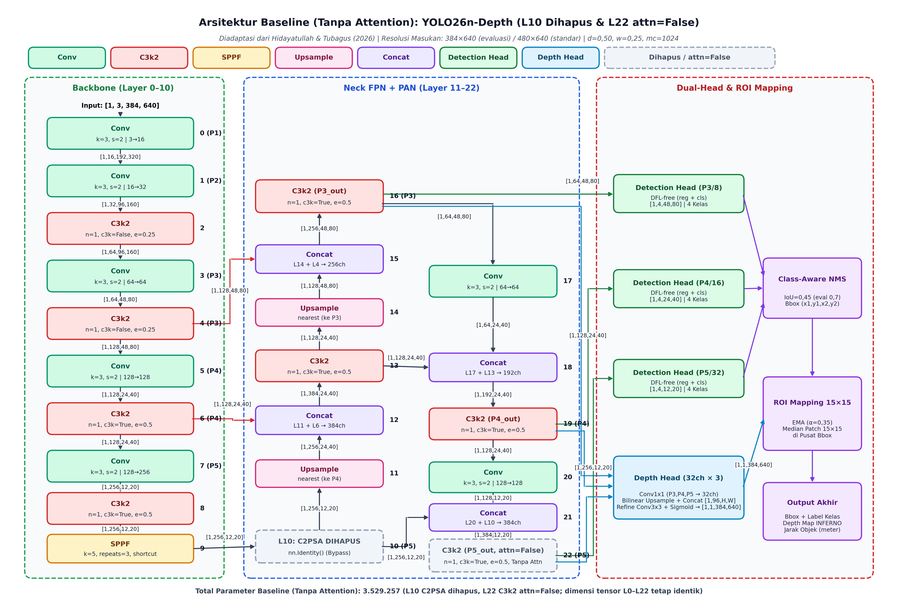
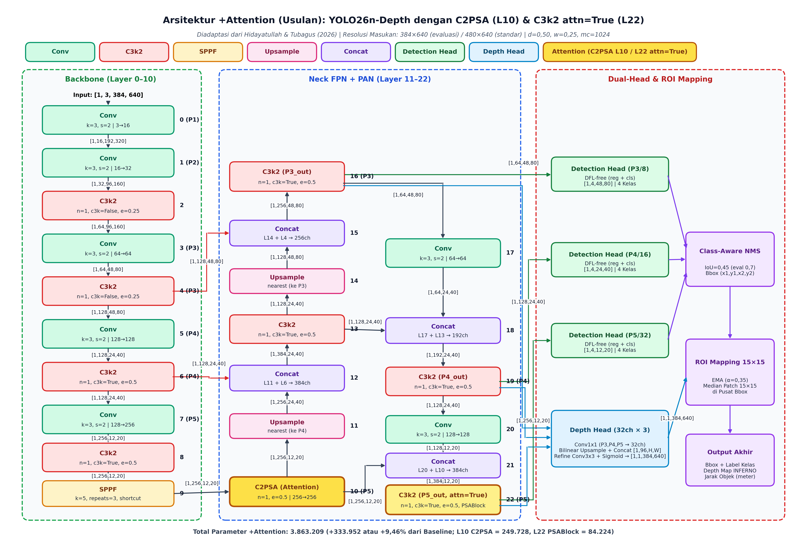

## 3.1.5 Alur Arsitektur Baseline (Tanpa Attention) dan Model Usulan (+Attention)

Sesuai pembaruan definisi model pada sistem, **Baseline** adalah arsitektur `YOLO26nDepthNoAttn` (`arsitektur_noattn.py`) **tanpa modul *attention*** (Layer 10 `C2PSA` dihapus/di-*bypass* dan Layer 22 `C3k2` pada *Neck* memakai `attention=False`), sedangkan **+Attention (Usulan)** adalah arsitektur lengkap `YOLO26nDepth` (`arsitektur.py`, *checkpoint* `rtx4050_arsitektur_70_20_10/best.pt`) mengikuti rancangan **Hidayatullah & Tubagus (2026)** dengan blok **`C2PSA` pada Layer 10** dan **`C3k2(attention=True)` pada Layer 22**.

**Tabel 3.1 Ringkasan Spesifikasi Arsitektur Model +Attention dan Perbedaannya dari Baseline**

| Komponen | Layer | +Attention (Usulan, `arsitektur.py`) | Baseline (Tanpa Attention, `arsitektur_noattn.py`) | Output Tensor (`384×640`) |
|----------|-------|--------------------------------------|----------------------------------------------------|---------------------------|
| **Compound Scaling** | 0–22 | `d=0,50, w=0,25, mc=1024` (**3.863.209** param) | Sama (**3.529.257** param; `-333.952` param) | - |
| **Backbone** | L0–L9 | `Conv`, `C3k2`, `SPPF (k=5, r=3)` | Identik | `P3: [1,128,48,80]`, `P4: [1,128,24,40]` |
| **Backbone Attention** | **L10** | **`C2PSA` (`n=1, e=0,5`, +249.728 param)** | **`nn.Identity()` (Dihapus / Bypass)** | `[1, 256, 12, 20]` |
| **Neck FPN+PAN** | L11–L21 | `Upsample`, `Concat`, `C3k2`, `Conv` | Identik | `P3_out: [1,64,48,80]`, `P4_out: [1,128,24,40]` |
| **Neck Attention** | **L22 (`n22`)** | **`C3k2` (`c3k=True, attn=True` / `PSABlock`, +84.224 param)** | **`C3k2` (`c3k=True, attn=False`)** | `P5_out: [1, 256, 12, 20]` |
| **Detection Head** | P3/P4/P5 | DFL-*free* (`reg` + `cls` 4 kelas) + Class-aware NMS | Identik | `[1,4,48,80]`, `[1,4,24,40]`, `[1,4,12,20]` |
| **Depth Head** | Dari P3/P4/P5 | Proyeksi 32ch + Bilinear Upsample + Refine + Sigmoid | Identik | `[1, 1, 384, 640]` (relatif `[0, 1]` × `10,0 m`) |

*Sumber: Diadaptasi dari Hidayatullah & Tubagus (2026) dan Verifikasi Kode Penulis ([verifikasi_layer.md](file:///c:/Users/ACER/Downloads/Comvis/code/docs/verifikasi_layer.md))*

*Gambar 3.4 Diagram Arsitektur Baseline (Tanpa Attention): Layer 10 (`C2PSA`) dihapus/bypass dan Layer 22 (`C3k2`) memakai `attn=False`. Diadaptasi dari Hidayatullah & Tubagus (2026).*

*Gambar 3.5 Diagram Arsitektur Model +Attention (Usulan): Layer 10 (`C2PSA`) dan Layer 22 (`C3k2, attn=True`) disorot sebagai modul attention. Diadaptasi dari Hidayatullah & Tubagus (2026).*

Penghapusan `C2PSA` pada Layer 10 (`249.728` parameter) dan *PSABlock* pada Layer 22 (`84.224` parameter) mengurangi total bobot sebesar **333.952 parameter (-8,64% dari +Attention, atau +9,46% dari Baseline)** dengan mempertahankan dimensi tensor keluaran `P3`, `P4`, `P5`, dan peta kedalaman tetap identik sehingga perbandingan latensi dan akurasi bersifat *apple-to-apple*.
