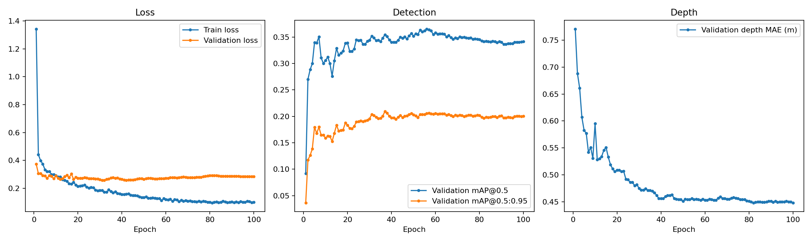

## 4.1 Evaluasi Kuantitatif dan Kurva Pelatihan

Sub-bab ini menyajikan spesifikasi perangkat keras serta lingkungan perangkat lunak desktop yang digunakan selama eksperimen, diikuti oleh kurva pelatihan dan ringkasan metrik pada *checkpoint* terbaik model **+Attention** (`YOLO26nDepth`, Epoch 56).

**Tabel 4.1 Konfigurasi Perangkat dan Lingkungan Pengujian**

| Parameter | Nilai / Spesifikasi |
|-----------|---------------------|
| Perangkat Pemroses (GPU / CPU) | GPU: NVIDIA GeForce RTX 4050 Laptop GPU (6 GB VRAM); CPU: Intel Core (Intel64 Family 6 Model 183 Stepping 1) |
| Sistem Operasi & Lingkungan | Windows 10/11 (Desktop), VS Code / Terminal; Python 3.10.0, PyTorch 2.5.1+cu121 (CUDA aktif), OpenCV 4.11.0, Ultralytics 8.4.148 |
| Kamera Pengujian | Webcam internal/eksternal laptop via OpenCV DirectShow (`cv2.CAP_DSHOW`, `scripts/capture_compare.py` / `main.py`) |
| Resolusi Masukan Model | Evaluasi akurasi & pelatihan **Baseline** & **+Attention**: **`384 × 640`** piksel (`letterbox`). Benchmark efisiensi diuji pada **`384 × 640`** dan **`480 × 640`** piksel (pembanding *legacy* `multitask_best.pt`: `480 × 640`) |
| Dataset & Pembagian (Split) | SUN RGB-D (`kv1`, 2.001 citra) + MS COCO 2017 (749 citra; 27,24% realisasi aktual); Split 70:20:10 = 1.922 Train / 553 Val / 275 Test (`seed=42`) |
| Kelas Objek Target (4 Kelas) | `person`, `laptop`, `cell phone`, `bottle` |
| Parameter *Post-Processing* | Conf. threshold UI `0,25` (evaluasi mAP `0,001`), Class-aware NMS IoU `0,45` (eval `0,7`), EMA $\alpha = 0,35$, skala depth `depth_max_m = 10,0 m`, ROI Mapping `15 × 15` piksel (median) |

*Sumber: Penulis*

Pelatihan model **+Attention** (`YOLO26nDepth`) dijalankan selama 100 epoch dan mencapai titik performa terbaik pada **Epoch 56** (*best validation loss* = `0,2567`). Model **Baseline (Tanpa Attention)** (`YOLO26nDepthNoAttn`) dilatih dengan setelan identik (100 epoch, `seed=42`, `384×640`).

*Gambar 4.1 Hasil Grafik Pelatihan Model +Attention (`YOLO26nDepth`, `C2PSA` L10 + `C3k2 attn=True` L22) selama 100 Epoch pada RTX 4050. Sumber: Penulis.*

**Tabel 4.2 Ringkasan Pembagian Dataset (Data Split 70:20:10)**

| Pembagian (Split) | SUN RGB-D | MS COCO | Total Gambar | Jumlah Kotak (*Bounding Box*) per Kelas |
|-------------------|----------:|--------:|-------------:|-----------------------------------------|
| Train (70%) | 1.398 | 524 | 1.922 | `person`: 1.377, `bottle`: 1.037, `laptop`: 326, `cell phone`: 210 |
| Validation (20%) | 403 | 150 | 553 | `person`: 475, `bottle`: 326, `laptop`: 85, `cell phone`: 73 |
| Test (10%) | 200 | 75 | 275 | `person`: 204, `bottle`: 250, `laptop`: 48, `cell phone`: 36 |
| **Total** | **2.001** | **749** | **2.750** | **Total 4.447 kotak** |

*Sumber: Penulis (diverifikasi dari `eval/dataset_stats.json`)*

**Tabel 4.3 Ringkasan Metrik Kinerja Model +Attention pada Checkpoint Terbaik (Epoch 56)**

| Split Data | Total Loss ↓ | Depth MAE (m) ↓ | mAP@0.5 (%) ↑ | Recall (%) ↑ |
|------------|-------------:|----------------:|--------------:|-------------:|
| Train | 0,1278 | - | - | - |
| Validation | 0,2686 | 0,455 | 36,55% | 81,13% |
| Test (275 citra) | 0,3559 | 0,533 | 30,87% | 78,62% |

*Sumber: Penulis (berdasarkan `training_runs/persist/rtx4050_arsitektur_70_20_10/evaluation.json` dan `eval/evaluation_results.json`)*

**Kesimpulan Sub-bab 4.1**: Kurva pelatihan model **+Attention** menunjukkan konvergensi hingga Epoch 56 (*validation depth MAE* turun dari `0,771 m` menjadi `0,455 m` dan *validation mAP@0.5* mencapai `36,55%`). Kenaikan tipis *validation loss* setelah Epoch 60 menandakan awal *overfitting*, sehingga pemilihan *checkpoint* Epoch 56 sudah optimal. Selisih performa *Validation* ke *Test* (`mAP@0.5` turun `5,68` poin, `Depth MAE` naik `0,078 m`) mencerminkan generalisasi pada *scene* yang belum pernah dilihat.
