## 4.4 Hasil Screenshot Pengujian dari Skenario Uji

Bagian ini menyajikan dokumentasi visual hasil pengujian pada dua kelompok: (1) sampel otomatis dari *held-out test split* (275 citra) untuk model **+Attention (`YOLO26nDepth`, Ep.56)** yang mencakup keempat kelas target serta kasus kegagalan, dan (2) *placeholder* pengujian *real-time* menggunakan webcam dan meteran fisik dari skenario Tabel 4.6 yang dijalankan dengan skrip `scripts/capture_compare.py` sesuai daftar pada `docs/checklist_screenshot.md`.

### Kelompok A: Pengujian pada Held-Out Test Split (Otomatis, 275 Citra)

#### 1. Pengujian Kelas `person`, `laptop`, `bottle`, dan `cell phone`

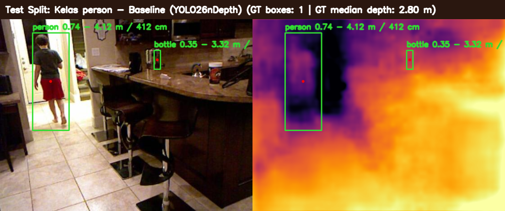

*Gambar 4.3 Pengujian Test Split Kelas `person` (`NYU0850.jpg`, SUN RGB-D) - Model `+Attention` (`YOLO26nDepth`, Ep.56) - jarak aktual kotak GT 4,17 m vs prediksi 4,12 m (412 cm). Sumber: Penulis.*

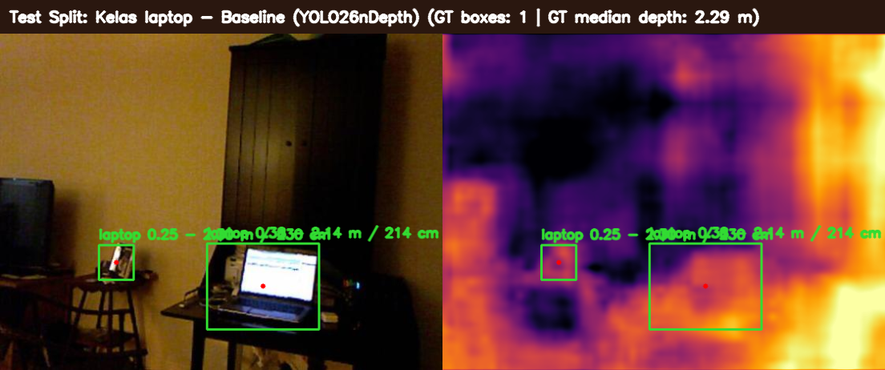

*Gambar 4.4 Pengujian Test Split Kelas `laptop` (`NYU0146.jpg`, SUN RGB-D) - Model `+Attention` (`YOLO26nDepth`, Ep.56) - jarak aktual kotak GT 1,89 m vs prediksi 2,13 m. Sumber: Penulis.*

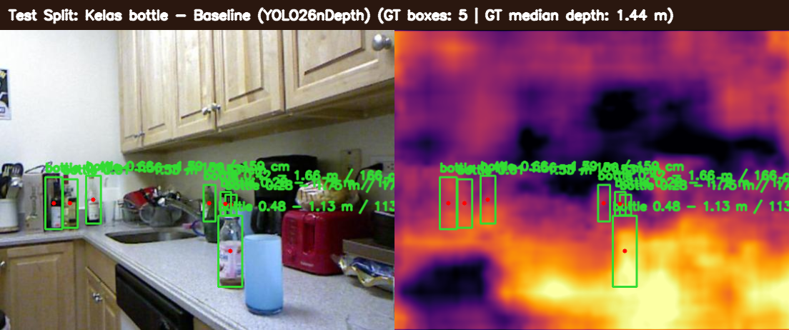

*Gambar 4.5 Pengujian Test Split Kelas `bottle` (`NYU0127.jpg`, SUN RGB-D) - Model `+Attention` (`YOLO26nDepth`, Ep.56) - jarak aktual kotak GT 2,02 m vs prediksi 1,54 m. Sumber: Penulis.*

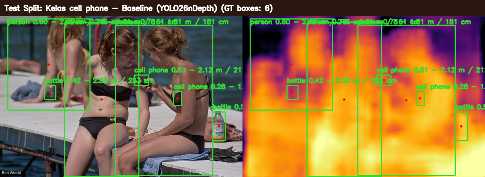

*Gambar 4.6 Pengujian Test Split Kelas `cell phone` (`000000352073.jpg`, MS COCO, tanpa GT depth) - Model `+Attention` (`YOLO26nDepth`, Ep.56). Sumber: Penulis.*

**Analisis Kelompok 1 (Keempat Kelas Target)**: Pada kelas berukuran besar dan menengah (`person` dan `laptop`), model `+Attention` mendeteksi kotak secara akurat dengan deviasi jarak ROI *15×15* berkisar 0,05–0,24 m terhadap *ground truth* SUN RGB-D. Pada kelas kecil (`bottle` dan `cell phone`), kontur objek pada peta kedalaman *INFERNO* cenderung menyatu dengan permukaan meja di sekitarnya sehingga estimasi jarak lebih sensitif terhadap pergeseran pusat kotak.

#### 2. Pengujian Kasus Gagal & Multi-Objek (*Clutter*)

*Gambar 4.7 Pengujian Kasus Gagal (*Small Object Missed*: `cell phone` pada `000000170716.jpg`, MS COCO) - Model `+Attention` (`YOLO26nDepth`, Ep.56). Sumber: Penulis.*

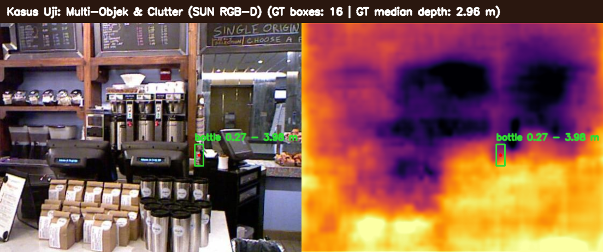

*Gambar 4.8 Pengujian Skenario Multi-Objek & *Clutter* (`NYU0121.jpg`, SUN RGB-D, 16 kotak GT) - Model `+Attention` (`YOLO26nDepth`, Ep.56). Sumber: Penulis.*

**Analisis Kelompok 2 (Kasus Gagal & Multi-Objek)**: Pada `000000170716.jpg` (Gambar 4.7), model berhasil mendeteksi dua `person` dan dua `bottle`, namun gagal mendeteksi `cell phone` kecil di atas meja (sejalan dengan `AP@0.5` `cell phone` yang rendah). Pada skenario *clutter* dengan 16 objek (Gambar 4.8), *overlapping* antar-benda di ruangan padat menyebabkan beberapa objek berdekatan tidak terdeteksi seluruhnya pada ambang `conf = 0,25`.

---

### Kelompok B: Pengujian Real-Time Webcam & Meteran Fisik (Side-by-Side Baseline vs +Attention)

Seluruh skenario berikut diambil langsung menggunakan `scripts/capture_compare.py` (panel kiri **Baseline**, panel kanan **+Attention**, beserta peta kedalaman *INFERNO* di bawahnya dan pencatatan otomatis ke `eval/webcam_measurements.csv`).

#### 1. Variasi Jarak pada Pencahayaan Terang (`person`)

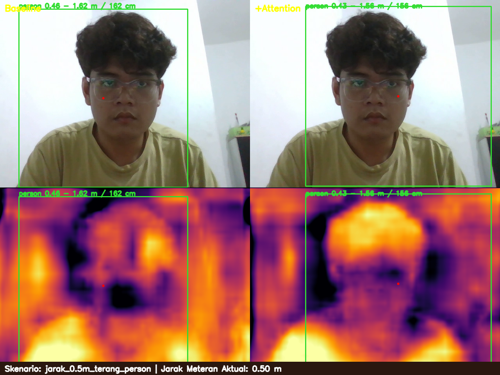

*Gambar 4.9 Pengujian Jarak Dekat 0,50 m (Terang, `person`) - Baseline vs +Attention - jarak aktual 0,50 m vs prediksi rata-rata 1,58 m (Baseline) dan 1,55 m (+Attention). Sumber: Penulis.*

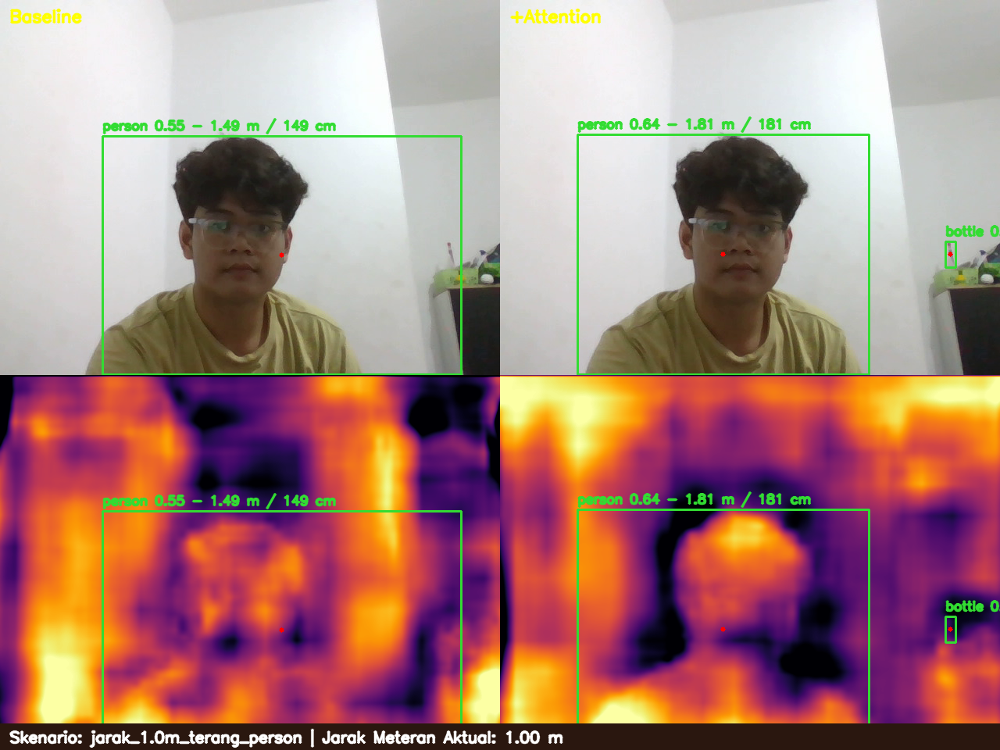

*Gambar 4.10 Pengujian Jarak Sedang 1,00 m (Terang, `person`) - Baseline vs +Attention - jarak aktual 1,00 m vs prediksi 1,49 m (Baseline) dan 1,81 m (+Attention). Sumber: Penulis.*

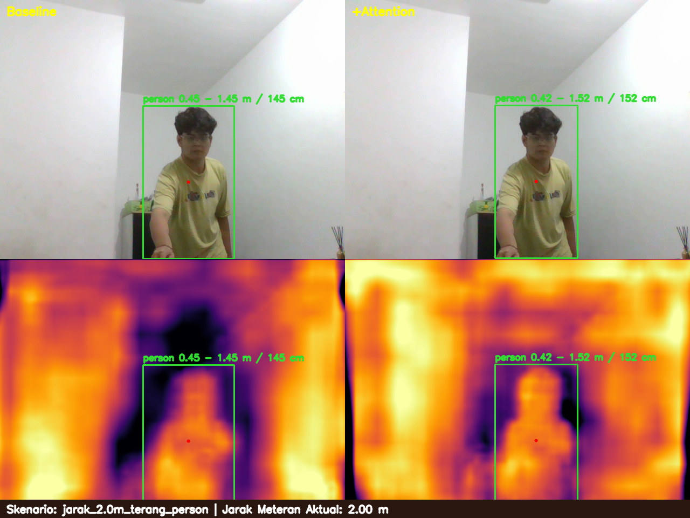

*Gambar 4.11 Pengujian Jarak Jauh 2,00 m (Terang, `person`) - Baseline vs +Attention - jarak aktual 2,00 m vs prediksi 1,45 m (Baseline) dan 1,52 m (+Attention). Sumber: Penulis.*

**Analisis Kelompok 3 (Terang `0,5–2,0 m`)**: Pada kondisi terang, kedua model mendeteksi `person` secara konsisten di ketiga jarak, namun prediksi jarak tanpa kalibrasi webcam cenderung berada di kisaran `1,45–1,81 m` akibat perbedaan karakteristik fokal webcam laptop dibanding sensor Kinect v1 SUN RGB-D.

#### 2. Variasi Pencahayaan Gelap (`person`)

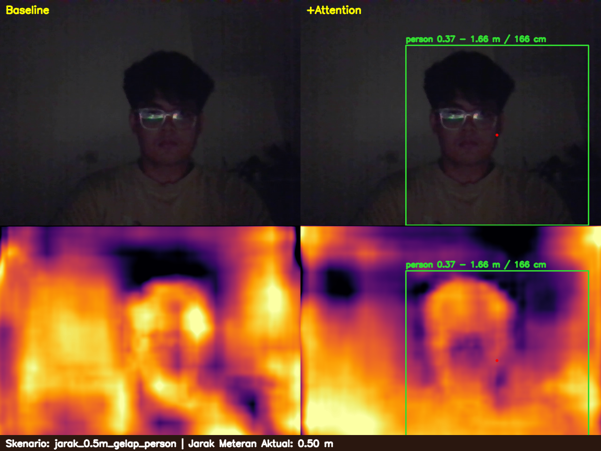

*Gambar 4.12 Pengujian Jarak Dekat 0,50 m (Gelap, `person`) - Baseline (tidak terdeteksi) vs +Attention (terdeteksi, prediksi 1,67 m) - jarak aktual 0,50 m. Sumber: Penulis.*

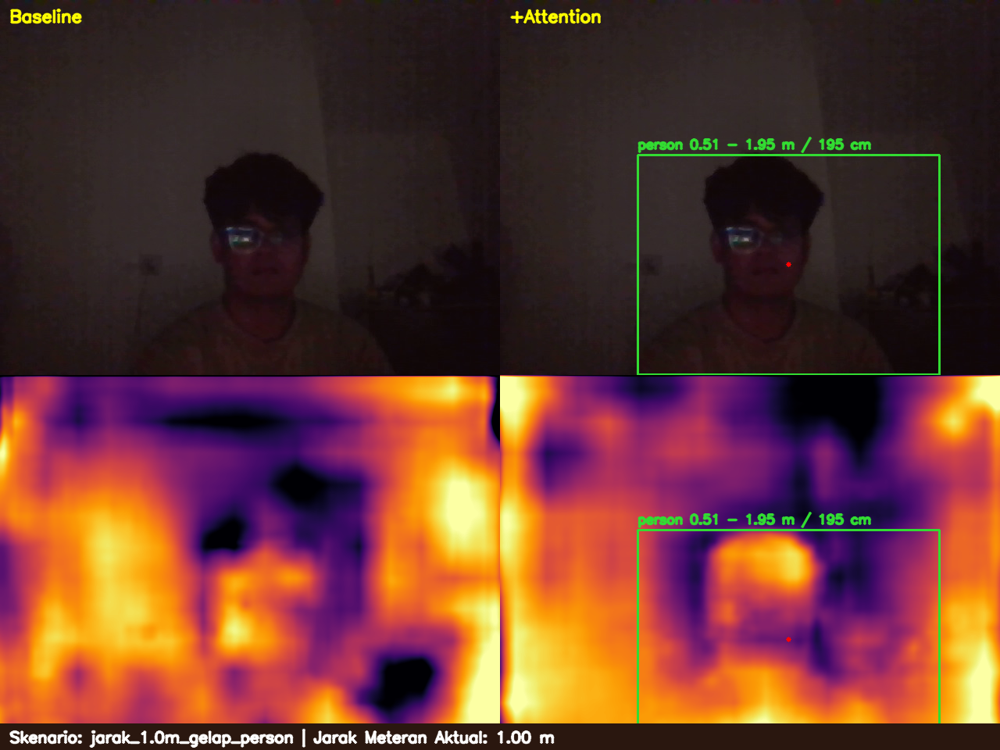

*Gambar 4.13 Pengujian Jarak Sedang 1,00 m (Gelap, `person`) - Baseline (tidak terdeteksi) vs +Attention (terdeteksi `conf 0,51`, prediksi 1,95 m) - jarak aktual 1,00 m. Sumber: Penulis.*

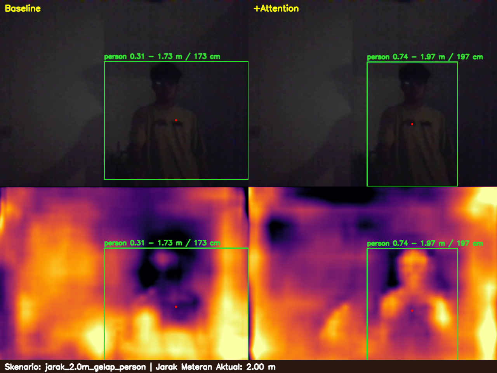

*Gambar 4.14 Pengujian Jarak Jauh 2,00 m (Gelap, `person`) - Baseline vs +Attention - jarak aktual 2,00 m vs prediksi 1,73 m (Baseline) dan 1,97 m (+Attention). Sumber: Penulis.*

**Analisis Kelompok 4 (Gelap `0,5–2,0 m`)**: Pada kondisi gelap di jarak `0,50 m` dan `1,00 m` (Gambar 4.12–4.13), **Baseline** gagal memunculkan deteksi `person` pada ambang `conf = 0,25`, sedangkan **+Attention** tetap mampu mendeteksi `person` dengan kontur *INFERNO* yang lebih terpisah dari latar belakang.

#### 3. Kondisi Khusus (*Occlusion* & Dinding Polos) dan Objek Lain

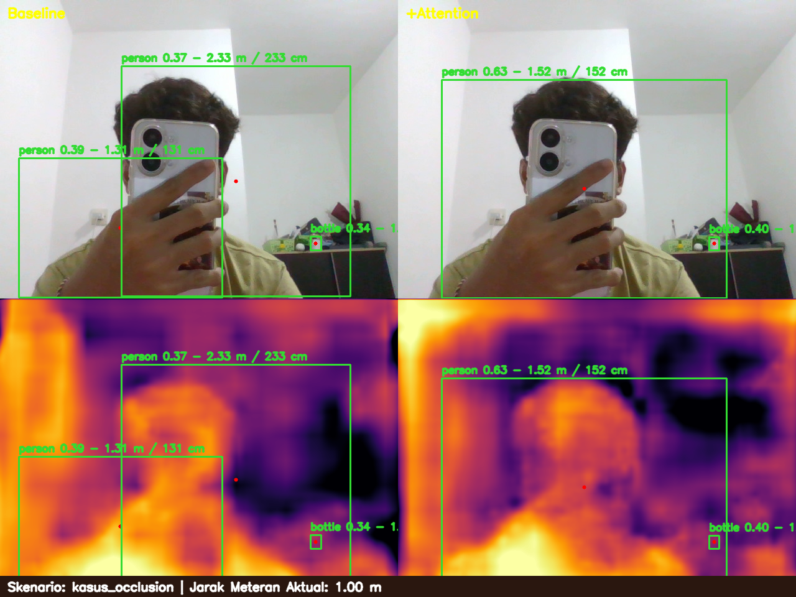

*Gambar 4.15 Pengujian Kasus Occlusion (`person` terhalang sebagian) - Baseline vs +Attention - jarak aktual 1,00 m vs prediksi 1,31 m (Baseline) dan 1,52 m (+Attention). Sumber: Penulis.*

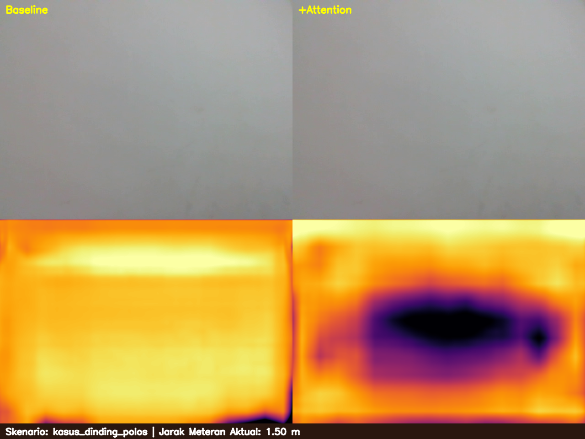

*Gambar 4.16 Pengujian Kasus Dinding Polos (*Low-texture*, jarak 1,50 m) - Baseline vs +Attention - tidak ada objek terdeteksi, terlihat artefak kedalaman di area minim tekstur. Sumber: Penulis.*

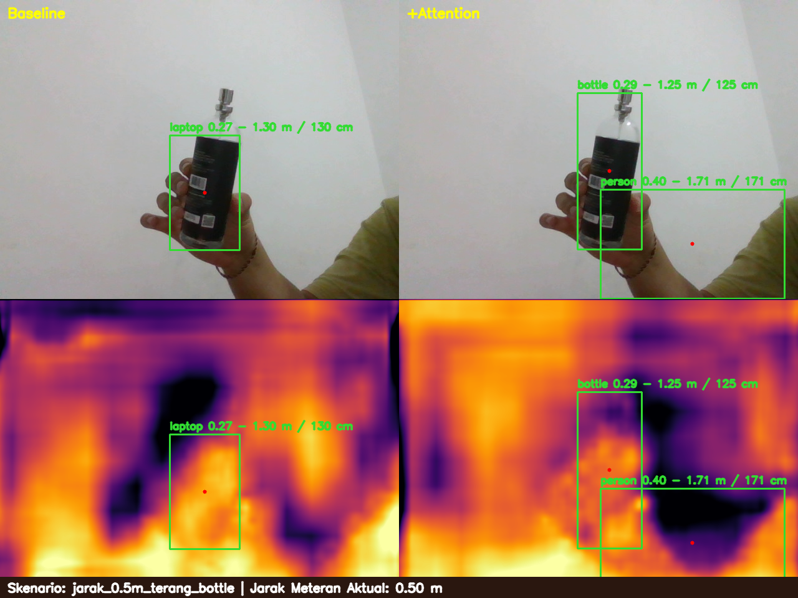

*Gambar 4.17 Pengujian Objek `bottle` 0,50 m (Terang) - Baseline vs +Attention - jarak aktual 0,50 m (deteksi terekam didominasi `person`/`laptop`). Sumber: Penulis.*

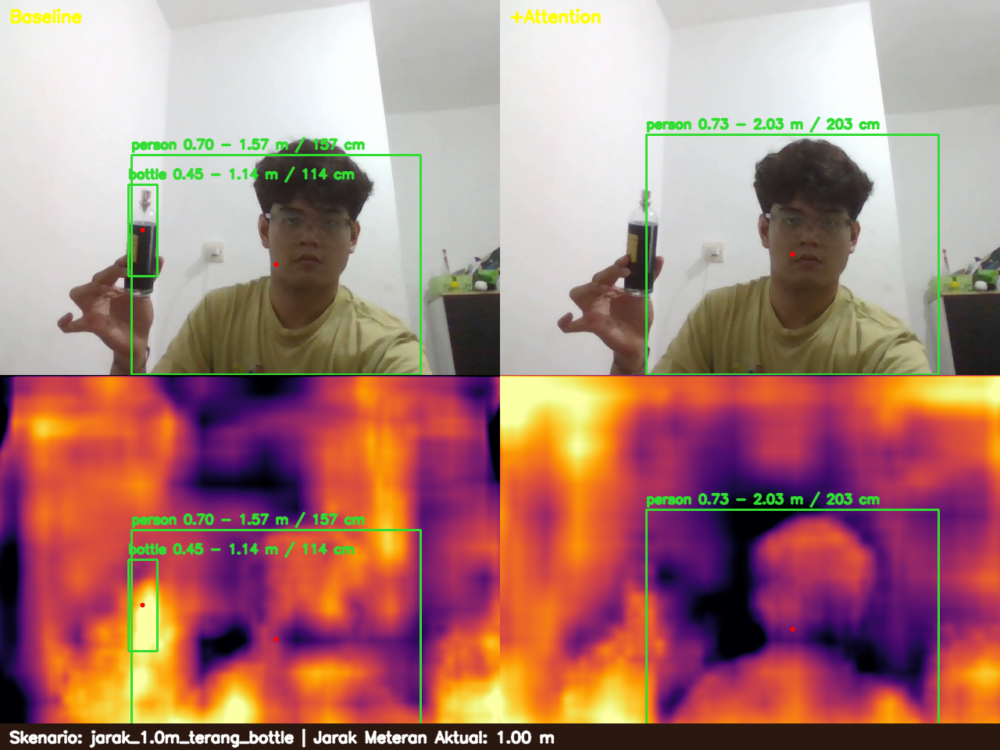

*Gambar 4.18 Pengujian Objek `bottle` 1,00 m (Terang) - Baseline vs +Attention - jarak aktual 1,00 m (deteksi terekam didominasi `person`). Sumber: Penulis.*

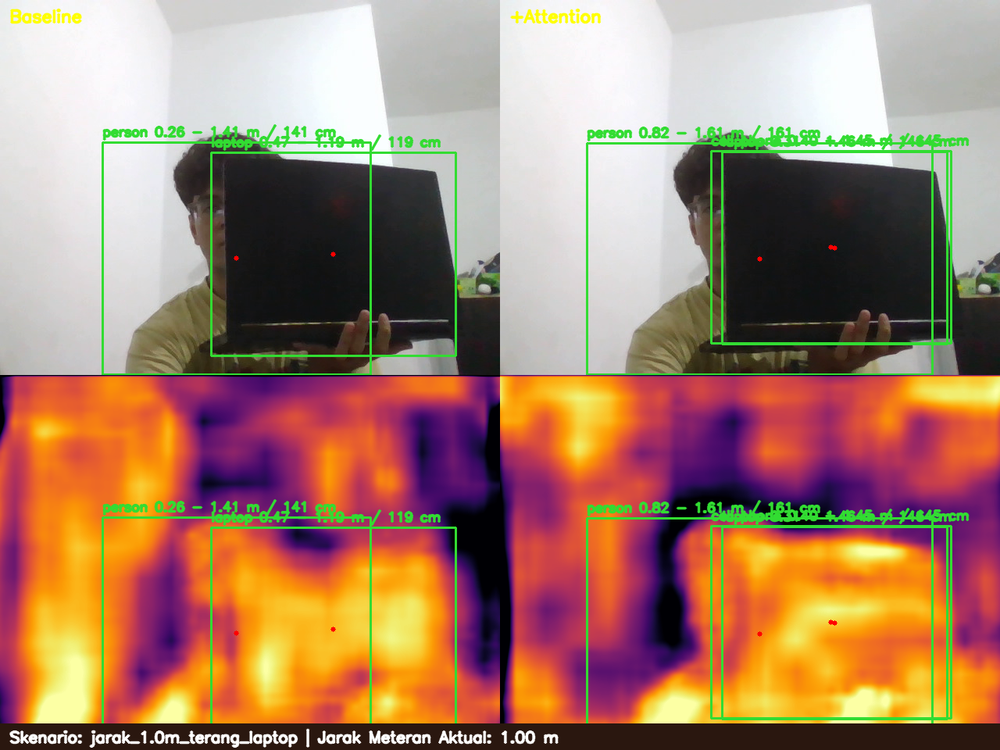

*Gambar 4.19 Pengujian Objek `laptop` 1,00 m (Terang) - Baseline (`laptop`, prediksi 1,19 m) vs +Attention (`person`, prediksi 1,61 m) - jarak aktual 1,00 m. Sumber: Penulis.*

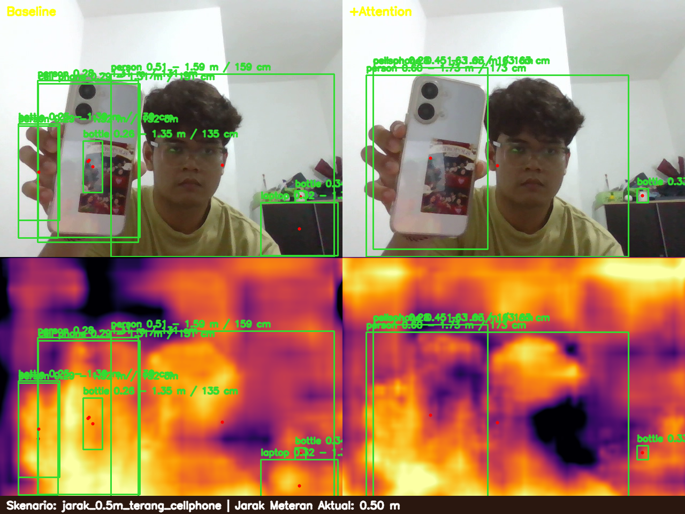

*Gambar 4.20 Pengujian Objek `cell phone` 0,50 m (Terang) - Baseline vs +Attention - jarak aktual 0,50 m (deteksi terekam didominasi `person` pemegang ponsel). Sumber: Penulis.*

**Analisis Kelompok 5 (Kondisi Khusus & Objek Lain)**: Pada skenario *occlusion* (Gambar 4.15), objek penghalang di depan tubuh menggeser pembacaan ROI pusat, sementara pada dinding polos (Gambar 4.16) minimnya tekstur menimbulkan bercak kedalaman gelap pada peta *INFERNO*. Pada pengujian `bottle` dan `cell phone` yang dipegang di depan tubuh (Gambar 4.17–4.20), deteksi kelas kecil masih kalah oleh kotak `person` ber-*confidence* tinggi, sejalan dengan `AP@0.5` kelas kecil pada Tabel 4.4.
