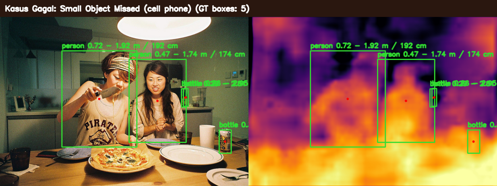

## 4.4 Hasil Screenshot Pengujian dari Skenario Uji

Bagian ini menyajikan dokumentasi visual hasil pengujian pada dua kelompok: (1) sampel otomatis dari *held-out test split* (275 citra) untuk model **+Attention (`YOLO26nDepth`, Ep.56)** yang mencakup keempat kelas target serta kasus kegagalan, dan (2) *placeholder* pengujian *real-time* menggunakan webcam dan meteran fisik dari skenario Tabel 4.6 yang dijalankan dengan skrip `scripts/capture_compare.py` sesuai daftar pada `docs/checklist_screenshot.md`.

### Kelompok A: Pengujian pada Held-Out Test Split (Otomatis, 275 Citra)

#### 1. Pengujian Kelas `person`, `laptop`, `bottle`, dan `cell phone`

*Gambar 4.3 Pengujian Test Split Kelas `person` (`NYU0850.jpg`, SUN RGB-D) - Model `+Attention` (`YOLO26nDepth`, Ep.56) - jarak aktual kotak GT 4,17 m vs prediksi 4,12 m (412 cm). Sumber: Penulis.*

*Gambar 4.4 Pengujian Test Split Kelas `laptop` (`NYU0146.jpg`, SUN RGB-D) - Model `+Attention` (`YOLO26nDepth`, Ep.56) - jarak aktual kotak GT 1,89 m vs prediksi 2,13 m. Sumber: Penulis.*

*Gambar 4.5 Pengujian Test Split Kelas `bottle` (`NYU0127.jpg`, SUN RGB-D) - Model `+Attention` (`YOLO26nDepth`, Ep.56) - jarak aktual kotak GT 2,02 m vs prediksi 1,54 m. Sumber: Penulis.*

*Gambar 4.6 Pengujian Test Split Kelas `cell phone` (`000000352073.jpg`, MS COCO, tanpa GT depth) - Model `+Attention` (`YOLO26nDepth`, Ep.56). Sumber: Penulis.*

**Analisis Kelompok 1 (Keempat Kelas Target)**: Pada kelas berukuran besar dan menengah (`person` dan `laptop`), model `+Attention` mendeteksi kotak secara akurat dengan deviasi jarak ROI *15×15* berkisar 0,05–0,24 m terhadap *ground truth* SUN RGB-D. Pada kelas kecil (`bottle` dan `cell phone`), kontur objek pada peta kedalaman *INFERNO* cenderung menyatu dengan permukaan meja di sekitarnya sehingga estimasi jarak lebih sensitif terhadap pergeseran pusat kotak.

#### 2. Pengujian Kasus Gagal & Multi-Objek (*Clutter*)

*Gambar 4.7 Pengujian Kasus Gagal (*Small Object Missed*: `cell phone` pada `000000170716.jpg`, MS COCO) - Model `+Attention` (`YOLO26nDepth`, Ep.56). Sumber: Penulis.*

*Gambar 4.8 Pengujian Skenario Multi-Objek & *Clutter* (`NYU0121.jpg`, SUN RGB-D, 16 kotak GT) - Model `+Attention` (`YOLO26nDepth`, Ep.56). Sumber: Penulis.*

**Analisis Kelompok 2 (Kasus Gagal & Multi-Objek)**: Pada `000000170716.jpg` (Gambar 4.7), model berhasil mendeteksi dua `person` dan dua `bottle`, namun gagal mendeteksi `cell phone` kecil di atas meja (sejalan dengan `AP@0.5` `cell phone` yang rendah). Pada skenario *clutter* dengan 16 objek (Gambar 4.8), *overlapping* antar-benda di ruangan padat menyebabkan beberapa objek berdekatan tidak terdeteksi seluruhnya pada ambang `conf = 0,25`.

---

### Kelompok B: Pengujian Real-Time Webcam & Meteran Fisik (Menunggu Aksi Manual)

Seluruh skenario berikut dijalankan menggunakan perintah `python scripts/capture_compare.py` (mode *side-by-side* `[Baseline | +Attention]` dengan jarak meteran tercetak pada *banner* dan pencatatan otomatis ke `eval/webcam_measurements.csv`).

- **Gambar 4.9** `[PLACEHOLDER MANUAL: docs/figures/webcam_captures/jarak_0.5m_terang_person_*.png]` — *Pengujian Jarak Dekat 0,50 m (Terang) - Baseline vs +Attention - jarak aktual 0,50 m vs prediksi [belum diukur].*
- **Gambar 4.10** `[PLACEHOLDER MANUAL: docs/figures/webcam_captures/jarak_1.0m_terang_person_*.png]` — *Pengujian Jarak Sedang 1,00 m (Terang) - Baseline vs +Attention - jarak aktual 1,00 m vs prediksi [belum diukur].*
- **Gambar 4.11** `[PLACEHOLDER MANUAL: docs/figures/webcam_captures/jarak_2.0m_terang_person_*.png]` — *Pengujian Jarak Jauh 2,00 m (Terang) - Baseline vs +Attention - jarak aktual 2,00 m vs prediksi [belum diukur].*
- **Gambar 4.12** `[PLACEHOLDER MANUAL: docs/figures/webcam_captures/jarak_0.5m_gelap_person_*.png]` — *Pengujian Jarak Dekat 0,50 m (Gelap) - Baseline vs +Attention - jarak aktual 0,50 m vs prediksi [belum diukur].*
- **Gambar 4.13** `[PLACEHOLDER MANUAL: docs/figures/webcam_captures/jarak_1.0m_gelap_person_*.png]` — *Pengujian Jarak Sedang 1,00 m (Gelap) - Baseline vs +Attention - jarak aktual 1,00 m vs prediksi [belum diukur].*
- **Gambar 4.14** `[PLACEHOLDER MANUAL: docs/figures/webcam_captures/jarak_2.0m_gelap_person_*.png]` — *Pengujian Jarak Jauh 2,00 m (Gelap) - Baseline vs +Attention - jarak aktual 2,00 m vs prediksi [belum diukur].*
- **Gambar 4.15** `[PLACEHOLDER MANUAL: docs/figures/webcam_captures/kasus_occlusion_*.png]` — *Pengujian Kasus Occlusion (Terhalang) - Baseline vs +Attention - jarak aktual 1,00 m vs prediksi [belum diukur].*
- **Gambar 4.16** `[PLACEHOLDER MANUAL: docs/figures/webcam_captures/kasus_dinding_polos_*.png]` — *Pengujian Kasus Dinding Polos (Low-texture) - Baseline vs +Attention - jarak aktual 1,50 m vs prediksi [belum diukur].*

**Analisis Kelompok 3 (Pengujian Webcam Real-Time)**: *[ISI SETELAH SCREENSHOT DAN DATA METERAN DIUKUR menggunakan `scripts/capture_compare.py` sesuai `docs/checklist_screenshot.md`.]*
